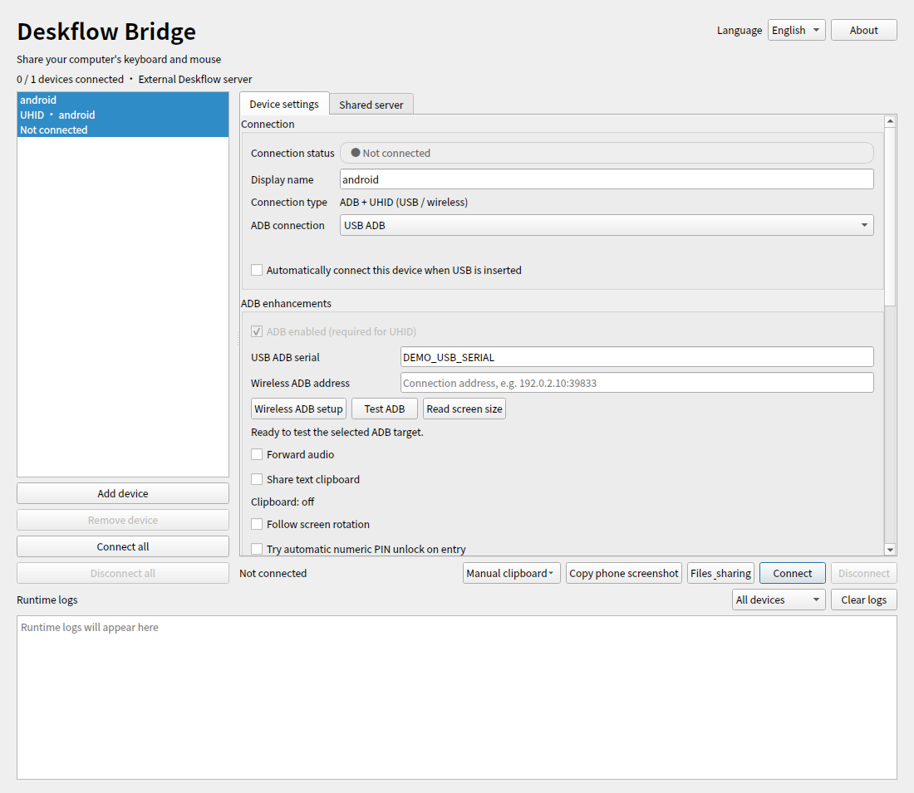

# deskflow-bridge

Control an Android phone with the keyboard and mouse you already use on your computer. Move the mouse across the edge of the desktop, use the phone's own screen, and move back again — without mirroring the phone into another window.

[简体中文](README.zh-CN.md) · [User guide](docs/USER_GUIDE.md) · [Latest release](https://github.com/gh6497/deskflow-bridge/releases/latest)

## Demo

https://github.com/user-attachments/assets/81770cd8-706e-4a28-956f-393e6d192490

*The phone screen was captured with scrcpy. Deskflow Bridge forwards keyboard and mouse input.*

> This project is a Deskflow client bridge for Android. It does not provide screen mirroring or turn the phone into a video display.

## What it does

- Shares one desktop keyboard and mouse with one or more Android phones.
- Makes each phone appear as a normal secondary screen in Deskflow.
- Supports clicking, dragging, scrolling, typing, Android Home/Back mouse mappings, and optional side-button gestures.
- Offers manual clipboard transfer and optional automatic text sharing, plus audio forwarding, screenshots, and file sharing through ADB.
- Provides a Qt GUI for Windows, macOS, and Linux, plus a command-line client.

## Download

Download a desktop package from the [latest release](https://github.com/gh6497/deskflow-bridge/releases/latest). Choose the GUI package for your operating system:

- **Windows:** installer or portable ZIP
- **macOS:** Intel or Apple Silicon DMG
- **Linux:** AppImage or Debian package

You must install [Deskflow](https://github.com/deskflow/deskflow) separately. The Deskflow Bridge package includes its own GUI runtime and, where applicable, ADB; it does not include Deskflow.

## Quick start



1. Install and start Deskflow on the computer that owns the keyboard and mouse.
2. Add the phone as a screen in Deskflow and place it next to the computer screen.
3. Start `deskflow-bridge-gui`. For USB or ADB, click **Add device** and choose its connection type. The type is fixed for that profile.
4. For USB or ADB, select the phone and set its dimensions in **Add device**. When ADB reports a device model, the window suggests a display name and a phone screen name. Make sure the screen name matches the Deskflow layout, then click **Connect**. The device appears in the list after Deskflow connects. For Bluetooth, click **Start Bluetooth service** under **Shared server**, then connect from the phone.
5. Move the mouse across the configured edge to enter the phone. Move it back to return to the computer.

The [illustrated user guide](docs/USER_GUIDE.md) covers installation, the first connection, permissions, troubleshooting, optional features, and multi-device setups. The [Chinese user guide](docs/USER_GUIDE.zh-CN.md) is also available.

## Choose a connection method

| Method | Best for | Phone setup | Notes |
|---|---|---|---|
| **ADB + UHID** | Windows and ADB users | Enable and authorize USB or wireless debugging | Uses the normal ADB driver; no WinUSB replacement. Recommended for a new Windows setup. |
| **USB AOA HID** | HID-only use | No ADB or USB debugging | Similar to scrcpy OTG. Linux needs USB permission; Windows needs a libusb-compatible driver. |
| **Bluetooth LE HID** | Linux, or Windows experimenters | Pair or connect from the phone's Bluetooth settings | Linux uses a shared directed service by default and can attach up to eight phones. Windows offers an experimental multi-device mode. macOS has no BLE backend. |

ADB is only required for ADB + UHID and for optional features such as audio, clipboard, rotation tracking, and file sharing. AOA HID can be used without USB debugging.

## Optional features

These features are separate from the basic keyboard and mouse path:

- [Audio forwarding](docs/AUDIO.md)
- [Manual and automatic text clipboard transfer](docs/CLIPBOARD.md)
- [Phone screenshot and file sharing](docs/FILE_SHARING.md)
- [Android companion app](docs/ANDROID_COMPANION.md)

## Important limitations

- A Deskflow server is required; this project does not replace Deskflow's server.
- The Android physical keyboard should use the English (US) layout. Other layouts are only partially adjusted.
- The default pointer uses absolute HID coordinates. Compatibility still depends on the Android device and ROM; real-device validation is ongoing.
- Windows BLE is experimental. Linux BLE has additional BlueZ, lifecycle, and adapter requirements; see its [handover document](docs/LINUX_BLE_HANDOVER.md).
- Windows installer and macOS DMG releases may be unsigned/not notarized. Verify that downloads come from this repository before running them.
- This project supports keyboard and mouse input, not gamepads or video output.

## Build from source

The command-line core is written in C11 and uses CMake. The GUI is optional and uses Qt 6.8+.

```bash
cmake -S . -B build -DOTG_PROFILE=full -DCMAKE_BUILD_TYPE=Release
cmake --build build --parallel
ctest --test-dir build --output-on-failure
```

See the [development guide](docs/DEVELOPMENT.md) for dependencies, platform-specific builds, packaging, architecture, protocol notes, and release procedures.

## Project status

The core Deskflow protocol and HID bridge are implemented and covered by offline regression tests. USB, UHID, and BLE compatibility still varies by operating system, Android version, phone model, USB driver, and Bluetooth stack. Please report both successful and failed real-device tests in [Issues](https://github.com/gh6497/deskflow-bridge/issues).

When reporting a problem, include:

- desktop OS and architecture;
- phone model and Android version;
- connection method and whether ADB is enabled;
- Deskflow version;
- relevant GUI or CLI logs, with private data removed.

## Contributing

Bug reports, compatibility results, documentation improvements, and pull requests are welcome. Start with the [development guide](docs/DEVELOPMENT.md), and keep the English and Chinese README/user-guide pairs synchronized when user-visible behavior changes.

## License

Apache-2.0. See [LICENSE](LICENSE) and [THIRD_PARTY.md](THIRD_PARTY.md).
