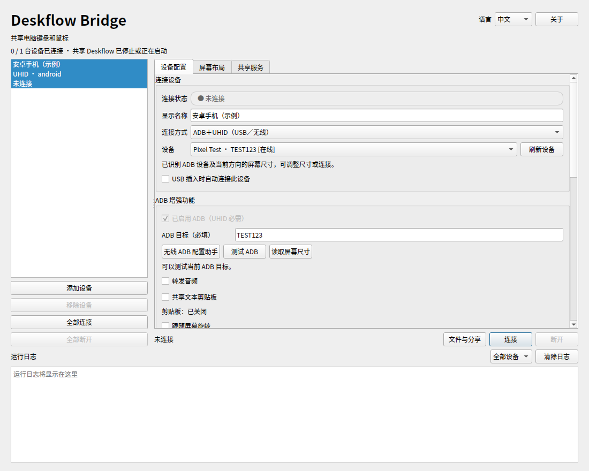

# deskflow-bridge

用电脑现有的键盘和鼠标控制安卓手机。鼠标滑过电脑屏幕边缘，就能在手机自己的屏幕上点击、滚动和打字；再滑回来即可继续操作电脑，**不需要把手机投屏到另一个窗口**。

[English](README.md) · [中文用户指南](docs/USER_GUIDE.zh-CN.md) · [最新版本](https://github.com/gh6497/deskflow-bridge/releases/latest)

## 操作演示

https://github.com/user-attachments/assets/81770cd8-706e-4a28-956f-393e6d192490

*手机画面通过 scrcpy 投屏录制，键鼠输入由 Deskflow Bridge 转发。*

> 本项目是连接 Deskflow 与 Android 的客户端桥接程序，不提供手机画面投屏，也不会把手机变成视频显示器。

## 它能做什么

- 让一套电脑键盘鼠标控制一台或多台安卓手机。
- 让每台手机在 Deskflow 中表现为一块普通的附加屏幕。
- 支持点击、拖动、滚轮、打字，以及中键 Home、右键 Back 和可选侧键手势。
- 通过 ADB 支持手动传输剪贴板文本、可选的自动同步、音频转发、手机截图和文件分享。
- 提供 Windows、macOS、Linux 的 Qt 图形界面，也提供命令行客户端。

## 下载

请从[最新 Release](https://github.com/gh6497/deskflow-bridge/releases/latest) 下载对应系统的桌面安装包：

- **Windows：** 安装程序或免安装 ZIP
- **macOS：** Intel 或 Apple Silicon DMG
- **Linux：** AppImage 或 Debian 安装包

需要另外安装 [Deskflow](https://github.com/deskflow/deskflow)。Deskflow Bridge 安装包包含自己的 GUI 运行库，以及适用时的 ADB；**不包含 Deskflow 本身**。

## 快速开始



1. 在持有键盘鼠标的电脑上安装并启动 Deskflow。
2. 在 Deskflow 中添加手机屏幕，并把它放在电脑屏幕旁边。
3. 启动 `deskflow-bridge-gui`，选择连接方式。
4. 在「设备配置 → 屏幕与显示」设置手机尺寸，然后点击**连接**。
5. 将鼠标滑过设置好的屏幕边缘进入手机；滑回来即可返回电脑。

[图文用户指南](docs/USER_GUIDE.zh-CN.md)介绍下载安装、首次连接、权限、故障排查、附加功能和多设备配置；也可以阅读[英文用户指南](docs/USER_GUIDE.md)。

## 选择连接方式

| 方式 | 适合场景 | 手机端准备 | 说明 |
|---|---|---|---|
| **ADB＋UHID** | Windows 和已经使用 ADB 的用户 | 开启并授权 USB 或无线调试 | 使用普通 ADB 驱动，不需要替换为 WinUSB。Windows 新配置推荐使用。 |
| **USB AOA HID** | 只需要键鼠控制 | 不需要 ADB 或 USB 调试 | 类似 scrcpy OTG。Linux 需要 USB 权限；Windows 需要 libusb 可用的驱动。 |
| **Bluetooth LE HID** | Linux，或愿意尝试的 Windows 用户 | 在手机蓝牙设置中配对或连接电脑 | 单机模式的手机地址选填。Linux 另提供[实验性双机模式](docs/USER_GUIDE.zh-CN.md#multiple)，需要已核验的 BlueZ 定向通知。macOS 暂无 BLE 后端。 |

ADB 只在 ADB＋UHID 以及音频、剪贴板、旋转跟随、文件分享等附加功能中需要。AOA HID 可以完全不开 USB 调试使用。

## 可选功能

这些功能与基础键鼠通道相互独立：

- [音频转发](docs/AUDIO.md)
- [手动和自动传输剪贴板文本](docs/CLIPBOARD.md)
- [手机截图和文件分享](docs/FILE_SHARING.md)
- [Android 伴侣应用](docs/ANDROID_COMPANION.md)

## 重要限制

- 必须有 Deskflow server；本项目不替代 Deskflow 的服务端。
- Android 物理键盘建议使用**英语（美国）**布局，其他布局只做部分修正。
- 默认指针使用绝对 HID 坐标，实际兼容性仍取决于手机型号、Android 版本和 ROM，真机验证仍在进行。
- Windows BLE 是实验功能；Linux BLE 也有额外的生命周期和蓝牙适配器要求，请看[交接文档](docs/LINUX_BLE_HANDOVER.md)。
- Windows 安装包和 macOS DMG 可能尚未签名或公证。运行前请确认下载来源是本仓库。
- 当前支持键盘和鼠标输入，不支持游戏手柄或视频输出。

## 从源码构建

命令行核心使用 C11 和 CMake，GUI 为可选组件，使用 Qt 6.8+。

```bash
cmake -S . -B build -DOTG_PROFILE=full -DCMAKE_BUILD_TYPE=Release
cmake --build build --parallel
ctest --test-dir build --output-on-failure
```

依赖、各平台构建、打包、架构、协议、测试和发布流程请看[开发指南](docs/DEVELOPMENT.zh-CN.md)。

## 项目状态

核心 Deskflow 协议和 HID 桥接已经实现，并有离线回归测试覆盖。USB、UHID 和 BLE 的兼容性仍会受到操作系统、Android 版本、手机型号、USB 驱动和蓝牙协议栈影响。欢迎在 [Issues](https://github.com/gh6497/deskflow-bridge/issues) 中报告真实设备上的成功和失败结果。

反馈问题时请尽量提供：

- 电脑操作系统和架构；
- 手机型号和 Android 版本；
- 连接方式，以及是否开启 ADB；
- Deskflow 版本；
- 相关 GUI 或命令行日志，并删除隐私信息。

## 参与贡献

欢迎提交 Bug、兼容性测试结果、文档改进和 Pull Request。请先阅读[开发指南](docs/DEVELOPMENT.zh-CN.md)；涉及用户可见行为时，请同步维护中英文 README 和用户指南。

## 许可证

Apache-2.0。详见 [LICENSE](LICENSE) 和 [THIRD_PARTY.md](THIRD_PARTY.md)。
