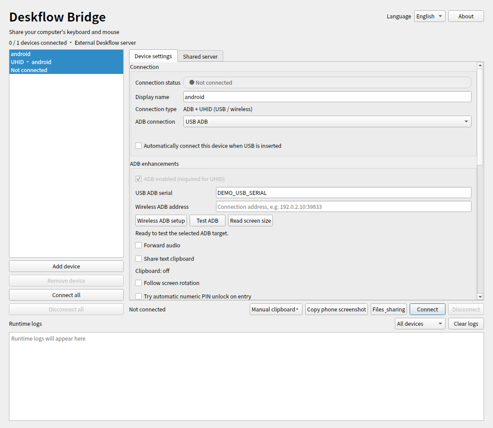
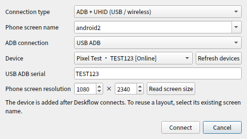
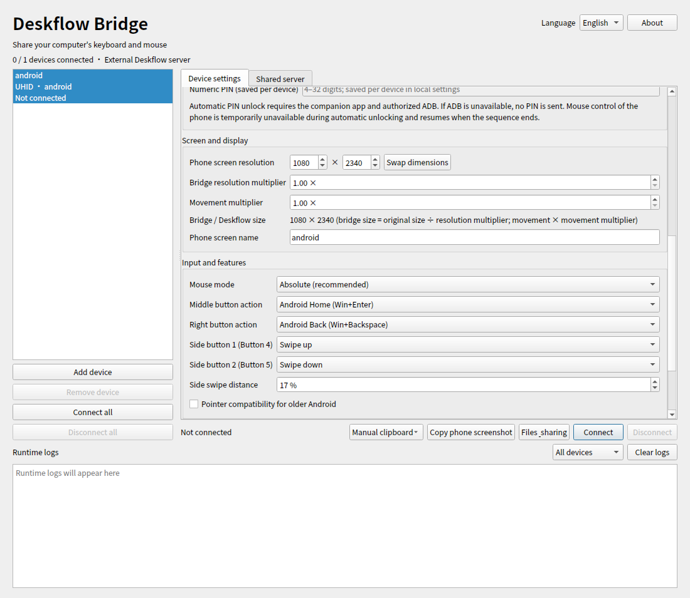

# Deskflow Bridge user guide

[简体中文](USER_GUIDE.zh-CN.md) · [Project home](../README.md) · [Download the desktop app](https://github.com/gh6497/deskflow-bridge/releases)

**Put your phone beside your computer and use one keyboard and mouse for both.** Move the pointer across the edge of your computer screen to click, scroll and type on Android; move it back to continue working on the computer.

This guide is for people installing and using the desktop app. No compilation is needed. You still look at the phone's own display: this project does not mirror its picture or turn it into an extended monitor for computer windows.

> Screenshots show the current, actual Linux GUI with demo devices and files. `TEST123`, addresses, installation paths and resolutions are examples; use your own values. Windows/macOS may look different, and some options depend on the platform and package version. Screenshots are not evidence of phone compatibility.

## Contents

- [1. What you can do](#features)
- [2. Download, install and prepare](#install)
- [3. Choose a connection type](#connection)
- [4. Find your way around](#interface)
- [5. First connection: USB cable + ADB + UHID](#first-connection)
- [6. Without USB debugging: USB (AOA HID)](#aoa)
- [7. Everyday use and pointer adjustments](#daily)
- [8. Enable optional features](#extras)
- [9. Connect multiple phones](#multiple)
- [10. Bluetooth connections](#bluetooth)
- [11. Troubleshooting](#troubleshooting)
- [Further reading](#more)

<a id="features"></a>

## 1. What you can do

- **Share keyboard and mouse**: clicks, dragging, scrolling and typing go to the phone while the pointer is on its screen.
- **Navigate Android**: assign the middle button to Home, the right button to Back, and side buttons to swipe up or down.
- **Switch between devices**: save separate settings for phones and tablets, then move between them using your screen layout.
- **Copy and paste text**: enable sharing to copy on the computer and paste on the phone, or synchronize text in the other direction.
- **Listen through your computer**: Linux/macOS/Windows can forward phone audio.
- **Transfer pictures and files both ways**: use the optional phone companion app to receive phone shares on the computer or send computer files to the phone.
- **Reduce repeated setup**: keep the app in the tray and reconnect remembered AOA or wired ADB + UHID phones when plugged in.

Start with keyboard and mouse control. Clipboard, audio and file sharing require ADB as well; file sharing also requires the companion app. Each is explained below.

<a id="install"></a>

## 2. Download, install and prepare

### Install two applications on the computer

1. Install [Deskflow](https://github.com/deskflow/deskflow/releases), which captures the computer's keyboard and mouse and handles screen switching.
2. Open this project's [Releases](https://github.com/gh6497/deskflow-bridge/releases), expand **Assets**, and download a desktop package whose name begins with **`deskflow-bridge-gui-`**.

Desktop packages contain the bridge, GUI runtime and ADB, but **do not include Deskflow**. You normally do not need to install scrcpy separately. GitHub's automatically generated `Source code` archives are not installers.

### Pick a package for your computer

| Computer | File to choose | How to start |
| --- | --- | --- |
| Windows x64 | `…-windows-x86_64-setup.exe` | Run the installer, then open Deskflow Bridge from the Start menu |
| Windows portable | `…-windows-x86_64.zip` (with `gui` in the name) | Extract everything and run `bin/deskflow-bridge-gui.exe`; run `Uninstall.exe` in the same folder to remove it |
| Ubuntu / Debian / Linux Mint x86_64 | `…-linux-amd64.deb` | Install with the system package installer, then open from the application menu |
| Other Linux x86_64 desktops | `…-linux-x86_64.AppImage` | Allow execution in file properties and double-click; the system needs FUSE |
| Apple Silicon Mac | `…-macos-arm64.dmg` | Open and drag the app into Applications |
| Intel Mac | `…-macos-x86_64.dmg` | Open and drag the app into Applications |

The Windows installer and macOS image are currently unsigned/not notarized, so the system may show a first-launch prompt. Check that the download came from the project release page above. On macOS, use “System Settings → Privacy & Security → Open Anyway” if needed. See the [README package instructions](../README.md#publishing-prebuilt-packages) for Linux installation commands and running an AppImage without FUSE.

### Phone and system permissions

- An Android phone or tablet and a USB cable that supports **data transfer**; charging-only cables will not work.
- Keep the phone unlocked during initial setup so you can approve requests and see the pointer.
- For ADB + UHID, enable USB debugging and authorize the computer. Root is not required.
- On macOS, give **Deskflow** Accessibility permission. Allow Input Monitoring or USB accessory access if requested.
- Linux Wayland desktops may ask you to approve keyboard/mouse sharing. USB access on Linux also needs the appropriate device permissions.

Use just one phone for your first setup.

<a id="connection"></a>

## 3. Choose a connection type

“AOA” and “UHID” are the mode names used in the interface. Choose mainly by how you want to connect and whether you want to enable debugging.

| What you want | Choose | Prepare |
| --- | --- | --- |
| A USB cable with debugging enabled, especially on Windows | **ADB + UHID (USB / wireless)** | Enable and authorize USB debugging; keep normal ADB drivers on Windows |
| Keyboard and mouse without USB debugging | **USB (AOA HID)** | USB access; Windows also needs a driver compatible with libusb |
| Control over Wi-Fi | **ADB + UHID (USB / wireless)** | A phone with wireless debugging, paired and connected |
| Bluetooth control without depending on ADB | **Bluetooth Low Energy** | Compatible Linux Bluetooth hardware/software, or a Windows package with experimental BLE |

**For your first connection, start with USB + ADB + UHID below**, particularly on Windows, where it avoids replacing USB drivers for AOA. If you do not want debugging, go to the [AOA instructions](#aoa).

Wireless ADB and Bluetooth are different connection types. macOS currently has no BLE mode. If an option is missing, check the features included in your release.

<a id="interface"></a>

## 4. Find your way around



- **Device list on the left**: select the phone to view, configure or connect. Buttons below add devices, connect all or disconnect all.
- **Device settings** shows the connection type chosen in **Add device** and lets you edit the target, dimensions and input features. **Scroll down inside the right-hand panel** to reach the screen settings, mouse buttons and companion app.
- **Shared server** holds Deskflow connection settings, executable paths and Bluetooth service settings. Arrange screens in Deskflow. The **Bluetooth service** section appears in builds that support BLE.
- The **Connect**, **Disconnect**, **Copy phone screenshot** and **Manual clipboard** buttons at the bottom right apply to the selected device. **Files & sharing** opens the file transfer window.
- **Runtime logs below**: read connection errors and filter by device.
- **Language at the top right**: switch between English and Chinese at any time. Appearance follows the system theme.

<a id="first-connection"></a>

## 5. First connection: USB cable + ADB + UHID

### Step 1: Make the phone available to the computer

1. Enable “Developer options” and “USB debugging” in the phone's settings. The location varies by brand; commonly, tap the build number repeatedly under “About phone”, then find Developer options in Settings.
2. Connect a data cable, unlock the phone, and approve this computer in the “Allow USB debugging” prompt.

For “Unauthorized”, check the phone's approval prompt, then refresh. If Windows never finds the device, check the manufacturer's ADB driver. This mode does not require replacing it with WinUSB.

### Step 2: Place the phone in Deskflow

In Deskflow, add a screen named `android` or choose your own name. Place it next to the computer screen and apply the layout. For example, place it on the right to reach the phone by crossing the computer's right edge.

### Step 3: Set up the server connection

Start the server in Deskflow. In Deskflow Bridge, open **Shared server** and enter the server address and port. For a local server, the defaults are `127.0.0.1` and `24800`.

If your server uses TLS, enable TLS and enter its server fingerprint. If it also requires client authentication, generate a client certificate and trust that client fingerprint in Deskflow. See the [TLS notes](DEVELOPMENT.md#security-and-tls).


**Optional automatic startup.** In Deskflow, use **Export server configuration** after arranging the screens. In the bridge, check **Start local Deskflow automatically**, select the exported **Deskflow configuration file**, and enter the computer screen name used in that file. Under **Programs and mode**, select `deskflow-core` or `deskflow-server` if the program was not found automatically. Stop any Deskflow server already listening on the same port. The bridge starts its server on Connect, using the exported file as-is. After changing the layout, export it again and restart the connection after all devices disconnect.

### Step 4: Add and connect the device



1. Click **Add device**. Choose **ADB + UHID** and **USB ADB**, then enter the screen name you set in Deskflow.
2. Click **Refresh devices** and select the phone marked **Online**. If the list contains a single device and it is online, the window fills its **USB ADB serial** automatically.
3. Click **Read screen size** or enter the phone's width and height for its current orientation. Click **Connect** in the same window.
4. Wait for the window to close and the device to appear in the list. If Deskflow reports an error, correct it and retry in the window, or click **Cancel** to discard the new device.

### Step 5: Try it

1. For a right-side layout, move the mouse to the computer's right edge and keep moving right. You should see a movable pointer on the phone.
2. Click a text field on the phone and type a few characters with the computer keyboard. Try scrolling, dragging and Back.
3. Move out of the phone screen toward the computer to return. With the phone on the right, leave through the phone screen's left edge.

After the app says Connected, also check that the phone actually responds. If there is no pointer, see [Troubleshooting](#troubleshooting).

<a id="aoa"></a>

## 6. Without USB debugging: USB (AOA HID)

This mode can provide keyboard and mouse control with a data cable, without ADB or the phone companion app.


1. Set the phone's position in Deskflow and configure **Shared server** as above.
2. Click **Add device**, choose **USB (AOA HID)** and enter the matching screen name.
3. Plug in the phone, click **Refresh devices** and select the matching USB device. If it is not found, check the cable and USB permissions. You can also enter the phone's USB serial manually.
4. Enter the phone's width and height for its current orientation, then click **Connect** in the same window. The device appears in the list after Deskflow connects.

Linux needs USB access permissions; see [Linux USB permissions](../README.md#rootless-usb-access-on-linux-udev-rule). Allow accessory access if macOS requests it. Windows AOA needs a libusb-compatible driver, which may conflict with existing ADB/file-transfer drivers. Read [Windows USB guidance](WINDOWS_USB.md) before changing drivers, or use ADB + UHID instead.

<a id="daily"></a>

## 7. Everyday use and pointer adjustments

### Click, go back and scroll

- Left-click to select; hold the left button while moving to drag.
- Use the wheel to scroll; the exact behavior depends on the phone app.
- Fresh GUI profiles assign the middle button to Android Home and the right button to Android Back. Select normal button behavior under **Input and features** if preferred. Existing profiles retain their saved choices.
- Side button 1 defaults to swipe up, and side button 2 to swipe down. **Side swipe distance** defaults to `17%`. Change the direction or restore normal side buttons as needed.
- Navigation mappings do not require the companion app or ADB. Home/Back depend on your phone system supporting the corresponding shortcuts.

### Pointer too slow or too fast



Disconnect the selected device before adjusting settings. Change one thing at a time:

- **Movement multiplier**: increasing it moves the phone pointer farther for the same computer mouse movement.
- **Bridge resolution multiplier**: increasing it makes the phone's virtual Deskflow screen smaller, also changing the movement needed to cross it. It **does not reduce the phone's actual display quality**.
- Prefer **Absolute (recommended)**. Relative mode is a compatibility option and may drift because of Android mouse acceleration.

If the absolute pointer stops around the middle of the screen on an older Android phone, disconnect that device and enable **Pointer compatibility for older Android** under **Device settings → Input and features**, then reconnect. The setting applies to that device's USB and Bluetooth connections.

After rotating the phone without rotation tracking enabled, disconnect, read the dimensions again or swap width/height, then reconnect.

### Disconnect, hide and quit

- **Disconnect** ends control of the selected device; **Disconnect all** ends all device sessions.
- **Closing the window** hides it when a system tray is available and keeps connections active. Click the tray icon or **Show window** to restore it.
- **Quit** from the tray menu to exit. Without a system tray, closing the window disconnects and exits.
- Complete the first connection in **Add device**. After Deskflow connects, the app saves the profile and adds it to the list. If the connection fails, you can edit the settings and retry in that window. Selecting a different saved device leaves the other connections active.

### Connect automatically when you plug in a USB cable

Select the phone's **ADB + UHID** or **USB (AOA HID)** profile. For UHID, authorize USB debugging, choose **USB ADB**, and select its USB ADB serial. AOA does not need USB debugging.

Enable **Automatically connect this device when USB is inserted** (off by default) and connect once by hand until the status reads **Connected**. Leave the app running, optionally hidden in the tray. Next time you plug in that phone, it reconnects automatically. If UHID is waiting for authorization, approve the prompt on the phone.

After a manual disconnect or failed connection, click **Connect** to retry immediately or unplug and reinsert the cable. Quitting the app stops detection; wireless ADB is not monitored by this option.

<a id="extras"></a>

## 8. Enable optional features

Disconnect the device you want to change, update **Device settings → ADB enhancements**, then reconnect. With AOA/BLE, enable ADB enhancements and select an authorized ADB target for **that same phone**. UHID already requires ADB. Bluetooth does not replace this ADB connection.

### Share the text clipboard

Enable **Share text clipboard**, connect, copy text on the computer, move to the phone and paste into a text field. Copying on the phone can synchronize text back to the computer. No companion app is needed.

This shares text; use **Files & sharing** below for pictures and files. Copying on a phone in the background may also update the shared clipboard.

### Transfer clipboard text manually

Select the phone on the left, then open **Manual clipboard** at the bottom of the window.

- **Copy from phone to computer** copies the latest text from the phone to the system clipboard of the computer running the GUI.
- **Send from computer to phone** copies the current text from this computer to the phone's clipboard. Paste it on the phone where you need it.

Each action transfers text once. Both work with **Share text clipboard** turned off and while Deskflow is disconnected. The selected phone must already be online and authorized in ADB. For AOA/BLE, enable **ADB enhancements**. For BLE, enter that phone's wireless ADB address.

Plain text up to 262,130 UTF-8 bytes is supported. The computer's clipboard is replaced only after a successful read. If the phone clipboard cannot be read, unlock the phone, copy some text and try again.

### Copy a phone screenshot

Select a phone on the left and click **Copy phone screenshot**. With the window hidden, choose **Copy phone screenshot → device name** in the tray. When the copy completes, press **Ctrl+V** (macOS: **⌘V**) in an app that accepts images. The screenshot goes to the clipboard of the computer running the GUI, even if the Deskflow server runs elsewhere.

The phone must already be online in ADB and have authorized the computer. For AOA/BLE, enable **ADB enhancements**; BLE requires that phone’s explicit wireless ADB address. No companion app, text sharing or active Deskflow session is needed. An offline phone, failed capture or timeout leaves the clipboard unchanged. Android may blank protected content.

### Forward phone audio

On Linux/macOS/Windows, enable **Forward audio** under **ADB enhancements** to play phone audio through the computer. This option is saved per device and is off by default. Android 11 or later and authorized ADB are required. Keep Android 11 unlocked when starting capture. Calls, protected content and apps that disallow capture may be silent.

**If the forwarded sound is too quiet:** disconnect the device, keep **Forward audio** checked, and set **Forwarded audio gain** just below it. Try `3 dB` or `6 dB` first, then reconnect and listen. The `0–12 dB` setting is saved per device; `0 dB` leaves playback unchanged. Boosting affects only sound played on the computer, does not change the phone's media volume, and cannot restore sound that was not captured. In Windows BLE mode, click **Stop Bluetooth service** under **Shared server → Bluetooth service** before reconnecting with a different gain.

On macOS, audio plays through the system default output (speakers or headphones), without microphone permission or an extra audio driver. If there is no sound, check the output device and volume in System Settings, then disconnect and reconnect after selecting an available output. An audio-output failure is logged and keyboard/mouse control remains available. Audio must be included in the build; older macOS packages may not show the switch.

Normal disconnection of an audio session tries to request playback pause. Unplugging or losing ADB can prevent that request; the companion below offers USB-disconnect pause.

### Follow screen rotation

Enable **Follow screen rotation** to update control dimensions as the phone rotates. UHID can do this on its own. AOA/BLE also need audio or clipboard enabled to keep an ADB session running.

### Wake the phone and unlock with a numeric PIN

UHID sends a wake action when the pointer enters the phone screen. You still need to unlock the phone normally. Optionally enable **Try automatic numeric PIN unlock on entry** and enter that phone's numeric PIN. After confirming the phone is locked through ADB, the app tries to open the PIN prompt and then sends the PIN followed by Enter.

By default the app presses Space to open the PIN prompt. If the phone's lock screen does not respond to Space, uncheck **Use Space instead of swiping** and reconnect to use an upward swipe. Swiping requires absolute mouse mode. This setting is saved per device.

This is optional. Enabling it stores the PIN in local computer settings, not runtime logs. Leave it off and unlock manually if you do not want the PIN stored on the computer.

On the OPPO R17 with Android 10, the PIN prompt stays blank when you type on a physical keyboard. Use the number row above the letters to enter the full PIN, then press the main Enter key. If you are unsure what you typed, use the phone's on-screen number pad to unlock.

### Install the optional phone companion

Keyboard/mouse, text clipboard and audio forwarding do not themselves need the companion. **File sharing, phone-side connection status and pausing media on USB disconnect** use it.

1. Confirm that the same phone is online and authorized in ADB. Scroll down to **Companion app (optional)** in device settings (USB/UHID page).
2. Desktop releases normally include the APK. Click **Install / update APK**; installation is not automatic.
3. Click **Open phone setup** and open the companion on the phone. For media pause/autoplay, manually allow notification access as prompted. File sharing alone does not need it.
4. If the phone restricts auto-start, background activity or battery use, allow the companion to run in the background without battery restrictions. Open it once after installation or an update.

To get phone notifications, turn on **Notify when Deskflow connects or disconnects** on the companion home screen (off by default) and allow Android notifications for the app. It does not need the notification access used for media controls. When the desktop GUI reports changes over authorized ADB, the phone alerts once on connection and once on disconnection. With the updated desktop and companion apps, the phone can alert on unplug for a confirmed wired session, even after ADB goes offline. Plugging or unplugging USB without a Deskflow session does not trigger an alert.

The companion can request that playing media pause when a USB data connection disconnects. Brief disconnections can trigger it too, and it is not limited to Deskflow USB sessions. Autoplay is a separate phone-side option, off by default, requiring a selected player. Whether media actions take effect depends on the player and system.

### Transfer pictures and files


**Phone → computer**

1. Select content in the phone's gallery, file manager or another app. Use Android **Share → Share to computer**.
2. Confirm **Prepare share** on the phone.
3. Select that phone in the desktop app and open **Files & sharing → Refresh phone shares**.
4. Select files, click **Receive selected**, and choose a destination folder on the computer.

**Computer → phone**

1. Click **Send files to phone** in the same window and select files, or drag local files into the window and confirm.
2. Wait for completion. Open **Files & sharing** in the phone companion, refresh, then use **Save as** to choose where to save a received file.
3. To place files in the gallery or a chosen folder automatically, enable automatic saving in the phone companion and grant access to the relevant destination.

Transfers do not overwrite or open files automatically. The per-file limit is `1 GiB`, with up to `32` files / `2 GiB` in phone staging storage. Files are supported, not whole folders. Shared text becomes a text file rather than a clipboard update. For long transfers, keep the companion foregrounded and the phone awake until finished. To transfer to another phone, close the file window, select that device and reopen it.

### Use wireless ADB

If your phone supports wireless debugging (usually Android 11+), UHID can work over Wi-Fi:

1. Put the phone and computer on the same reachable network and enable **Developer options → Wireless debugging** on the phone.
2. For a new device, open **Add device**, choose **ADB + UHID** and **Wireless ADB**, then open **Wireless ADB setup**. For a saved device, open the helper in its settings. Choose pairing with a code on the phone.
3. Select the discovered pairing address or enter the IP and port shown in the phone's pairing dialog. Enter its six-digit pairing code and pair.
4. Then select the connection address and port shown on the phone's main **Wireless debugging** page. In an ADB + UHID profile, a successful connection fills **Wireless ADB address** and selects **Wireless ADB**. If you already know the connection address, enter it directly and select **Wireless ADB**.
5. Read dimensions and click **Connect**. The profile keeps both targets and remembers your last selection. Disconnect before switching. Inserting a USB cable leaves an active wireless session in place.

**Pairing and connection ports can differ.** Addresses/ports may also change after switching networks or restarting wireless debugging. Update the target if needed. The companion's wireless ADB helper opens system settings; it cannot approve authorization for you.

<a id="multiple"></a>

## 9. Connect multiple phones


1. Add a screen in Deskflow for each phone and arrange them. If you use automatic startup, export the updated configuration from Deskflow and select it in **Shared server**.
2. For each phone, choose **Add device**, enter a matching screen name such as `android2` or `android3`, select the target and click **Connect** in that window. Other phones can stay connected.
3. To use AOA and ADB + UHID for the same phone, create a second profile using its existing screen name. Give the profiles distinct **Display names** if helpful.
4. Reconnect saved devices individually or with **Connect all**.

Only one profile can use a Deskflow screen at a time. Only one profile for that screen can have USB auto-connect enabled. If several profiles for the same screen are ready, **Connect all** uses the one with USB auto-connect enabled, or asks you to connect one manually.

To remove a device, select it in the list and click **Remove device** after it has disconnected. Other phones can stay connected. Keep at least one device in the list. If Windows is still keeping the device's Bluetooth service running, click **Stop Bluetooth service** first. To change **Shared server** settings, disconnect all devices first.

Multiple AOA/UHID devices can connect together. The default Bluetooth service supports one phone. The experimental Linux service allows up to eight BLE phone sessions on one adapter. The number of simultaneous connections depends on the controller, and this hardware combination has been tested with two phones. Each phone has its own screen. Input follows the pointer.

**Connecting multiple BLE phones on Linux**

1. Use a BlueZ build with directed notifications (upstream 5.76+ or a verified backport). Stock Ubuntu `5.72-0ubuntu5.8` supports the single-phone workflow. From the source directory, set `FIXED_DAEMON` to a trusted reference executable that includes the fix, then run the verification below. The helper compares it byte for byte with the running daemon. Repeat verification after restarting BlueZ.

   ```sh
   sudo sh scripts/ble-verified-instance.sh "$FIXED_DAEMON"
   ```

2. Disconnect all devices and stop any idle single-phone service. Under **Shared server → Bluetooth service**, select the adapter, enable **Allow multiple Bluetooth phones** and click **Start Bluetooth service**. If any phone needs **Keyboard and mouse compatibility for older Android**, enable it before starting. The multi-device service requests administrator authentication and temporarily disconnects Bluetooth devices on the selected adapter to switch it to BLE-only mode.
3. From each phone's system Bluetooth settings, connect to **Deskflow Bridge**. The GUI creates or reuses a profile for each phone. Add its screen name to Deskflow if prompted. You can disconnect one phone without stopping the other sessions. The service continues to accept phones while there is capacity.
4. If the device status says **Bluetooth link connected. Waiting for keyboard and mouse**, turn Bluetooth off and on on **that phone**, then connect from its Bluetooth settings. If the keyboard and mouse are ready but the bridge is still connecting to Deskflow, check the server address, TLS settings and the phone's screen name. Click **Stop Bluetooth service** to end discovery and release the Bluetooth sessions while keeping USB and ADB + UHID sessions connected.

Before adding/removing devices or changing screen names, layout or the shared server, disconnect all and wait for shutdown to finish. Connected-device parameters are locked, while connection targets and dimensions for other idle devices remain editable.

<a id="bluetooth"></a>

## 10. Bluetooth connections

BLE lets the phone treat the computer as a Bluetooth keyboard/mouse without USB debugging for basic input. Adapter and phone compatibility matter, so try wired control first to learn the basics.

- In **Linux single-phone mode**, set the adapter (usually `hci0`) under **Shared server → Bluetooth service** and click **Start Bluetooth service**. Pair or connect to **Deskflow Bridge** from the phone. Keep it as the adapter's only LE connection. Classic Bluetooth can coexist when Linux can verify both input subscriptions belong to the phone.
- On **Windows**, click **Start Bluetooth service** under **Shared server** in a build with experimental BLE, then pair or connect to the PC from the phone. Windows uses the default adapter.
- **macOS**: no BLE backend currently; consider wireless ADB + UHID for wireless control.

Check **Service status** under **Shared server → Bluetooth service**. On Linux, it refreshes about every two seconds while the page is visible and shows whether the selected adapter's service is available, idle, in use, or ready to send keyboard and mouse input. On Windows, it shows the service started by this app, including when it is kept idle after disconnecting or when its session has connected to Deskflow.

The phone appears in the device list once it subscribes to keyboard and pointer input. The GUI reuses its saved Bluetooth profile on later connections. You can set the screen dimensions and turn **Automatically connect discovered phones to Deskflow** on or off in its profile. See the [Linux BLE notes](LINUX_BLE_HANDOVER.md) and [Windows Bluetooth guide](WINDOWS_BLE.md).

To change a connected phone's screen dimensions or mouse buttons, select it in the device list, click **Disconnect** and wait for disconnection to finish. After editing, click **Reconnect to Deskflow** for the selected phone. This button also works with automatic connection turned off. If the phone has lost its Bluetooth link, reconnect to the computer in the phone's Bluetooth settings.

Use **Stop Bluetooth service** under **Shared server → Bluetooth service** to end discovery and disconnect the Bluetooth sessions in this window. USB and ADB + UHID connections remain active. On Linux, the app also stops the resident service once it is idle. On Windows, use this button before reconnecting with changed TLS or ADB settings. Phones may need to reconnect through their Bluetooth settings after a service restart.

If an older Android phone pairs on Linux but its keyboard and mouse stay unavailable, use **Stop Bluetooth service** under **Shared server → Bluetooth service**, then enable **Keyboard and mouse compatibility for older Android** and reconnect. This setting applies to every phone using the shared adapter. If the phone still uses cached Bluetooth settings, turn its Bluetooth off and on. If necessary, remove the pairing on both devices and pair again. If the phone only makes a classic Bluetooth connection, use **Temporarily use BLE-only mode (administrator authentication)** in the same section to test BLE. That option temporarily disconnects all devices on the adapter.

When you upgrade from an older version on Linux, the shared Bluetooth settings start with those of the first saved Bluetooth device. If your old device settings differed, check the new shared values under **Shared server**.

**If the pointer moves in steps**, check the connection interval in the log, if available. A longer interval gives the phone fewer opportunities to receive new positions. On Windows, look for `BLE negotiated connection interval` (`12500us` means 12.5 ms). On Linux with isolation enabled, look for `BLE actual interval`. Include that line and say whether you see the steps when moving, dragging, or both.

### Find the computer with the companion app

1. Start the phone’s BLE session in the desktop GUI. On the phone, open **Bluetooth connection → Scan for BLE devices** in the companion app. Allow Nearby devices on Android 12 or later. On Android 10 and 11, grant Location permission and turn on Location for the scan.
2. Tap the computer in the scan results to fill in its address. If the list is empty, enter the computer adapter’s public Bluetooth address. **Test LE connection** tries that address and reports the result. If it times out, check that the address is correct and the computer is advertising.
3. Tap **Connect to computer**. Confirm any system pairing prompts. The app remembers the computer address and shows the Bluetooth link status and type when Android reports them. Check the desktop connection status and try the keyboard and mouse.

The phone can open and check the Bluetooth link without ADB. Its home screen shows the Deskflow connection status and method (AOA HID, ADB + UHID, or BLE HID) when the updated desktop GUI reports them over authorized ADB. See the [Android companion app documentation](ANDROID_COMPANION.md#ble-diagnostics).

<a id="troubleshooting"></a>

## 11. Troubleshooting

| What you see | What to check first |
| --- | --- |
| Connection rejected with a configuration error | The status and runtime log identify the first invalid field and its requirement (for example, port 1–65535, width/height 1–32767, missing ADB target or conflicting TLS fingerprint settings). Correct that field and connect again; any remaining error is shown on the next attempt. PIN values are never included in these messages |
| No phone after refreshing | Try a data-capable cable/USB port. UHID: debugging authorization and ADB driver. AOA: USB permissions and driver |
| Unauthorized or Offline | Unlock and approve the computer, then refresh. For wireless, check the current IP, connection port and network |
| Deskflow not found | Install Deskflow and select `deskflow-core` / `deskflow-server` under Shared server, rather than its GUI |
| Automatic startup asks for a Deskflow configuration file | Arrange the screens in Deskflow, export the server configuration and select it under **Shared server**. You can also turn off automatic startup and start the server in Deskflow |
| Port already in use | Check for a manually started Deskflow server. Use existing-server mode or another free port for automatic startup |
| Linux Bluetooth service unavailable | Check **Service status** for the selected adapter under **Shared server → Bluetooth service**. If starting the service fails, open the service log at the path shown in the runtime log |
| Deskflow asks to add the phone screen on first connection | Accept the prompt on the server, place the screen in its layout, and apply the changes. The bridge retries automatically for USB AOA, ADB + UHID and Bluetooth. If it keeps waiting, check that the screen name shown in the bridge matches the server layout exactly. Click **Disconnect** to cancel. |
| Connected, but cannot move onto the phone | Check the screen name and layout in Deskflow. If using automatic startup, make sure it uses the latest export. Also check Deskflow's input-capture/Accessibility permissions and any screen-switch lock |
| No phone pointer or no response to clicks | Check logs for UHID unavailable or USB errors. Start with absolute mode; try relative mode after disconnecting for an incompatible device |
| Wrong orientation or strange movement range | Disconnect and read current dimensions or swap width/height; reset both multipliers to 1 first |
| Some symbols type incorrectly | Set the phone's physical keyboard to English (US). Deskflow protocol 1.8 with per-key language information can correct common symbols and digits such as `@`, `#`, and `1` from other host layouts. The bridge does not switch the phone's layout or correct accented letters and dead keys. |
| Clipboard, audio or files fail | Check that this phone's ADB target is online and authorized. Files also need an updated, opened companion; audio needs a supported platform and Android version |
| Sent files do not appear in the phone gallery | Refresh Files & sharing in the companion and Save as, or enable the relevant automatic saving; files first use private companion storage |
| Control continues after closing the window | Closing hides to the tray when available; use Disconnect or Quit from its menu |

The app's own runtime messages use the selected interface language. External output under labels such as `[ADB output]` and `[Deskflow output]` is left untranslated for troubleshooting. Switching languages affects new entries, not the ones already displayed.

**To report a problem**, check the version under **About**, note the computer OS, phone model/Android version, connection type and steps, and include relevant runtime logs or screenshots in [project Issues](https://github.com/gh6497/deskflow-bridge/issues). Remove device identifiers or paths you do not want public, and do not attach a PIN or private-key file.

<a id="more"></a>

## Further reading

The guide above is enough for everyday use. These references cover detailed setup and troubleshooting; most feature-specific technical documents are currently in Chinese:

- [ADB + UHID device requirements](UHID.md)
- [Windows USB drivers and discovery](WINDOWS_USB.md)
- [Audio forwarding](AUDIO.md) · [Text clipboard](CLIPBOARD.md)
- [Android companion app](ANDROID_COMPANION.md) · [File sharing](FILE_SHARING.md)
- [Windows BLE](WINDOWS_BLE.md) · [Linux BLE compatibility records](LINUX_BLE_HANDOVER.md)
- [Technical overview, CLI and building from source](../README.md)
