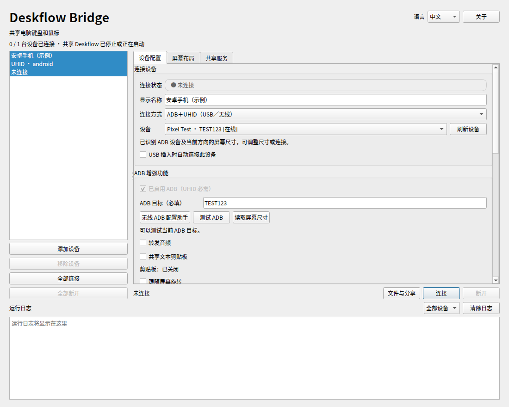
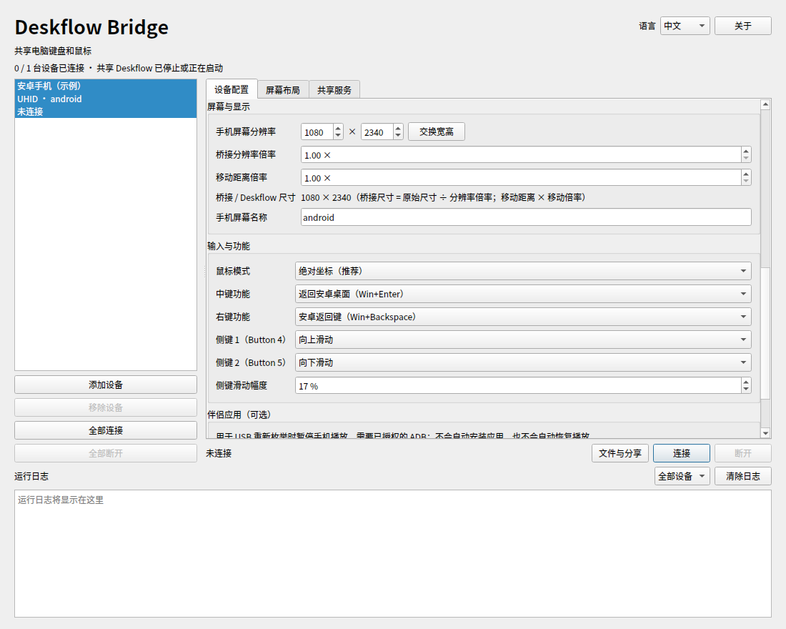
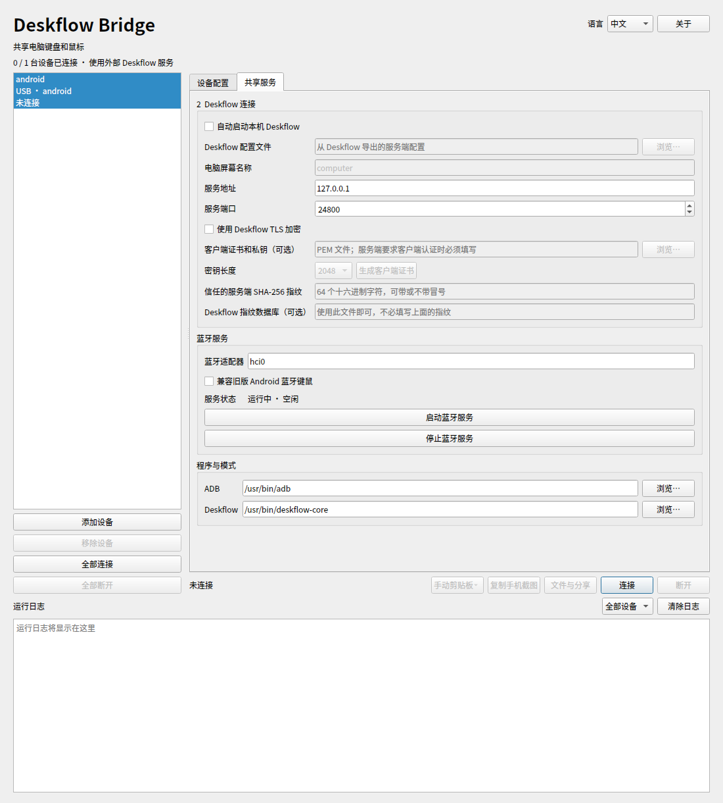
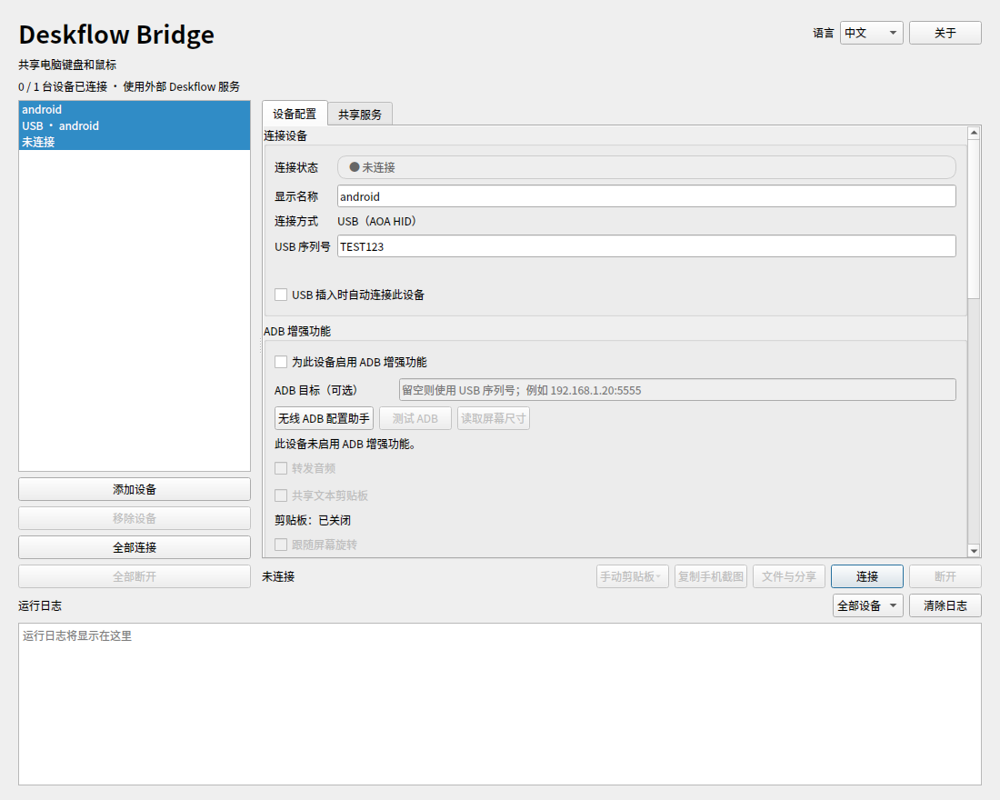
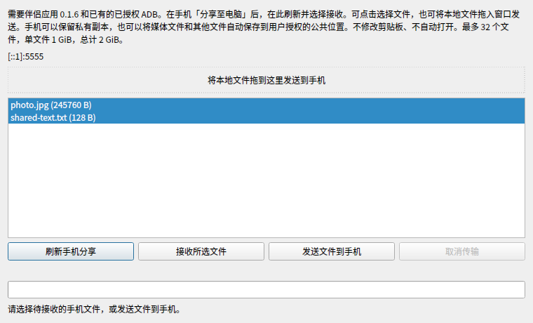
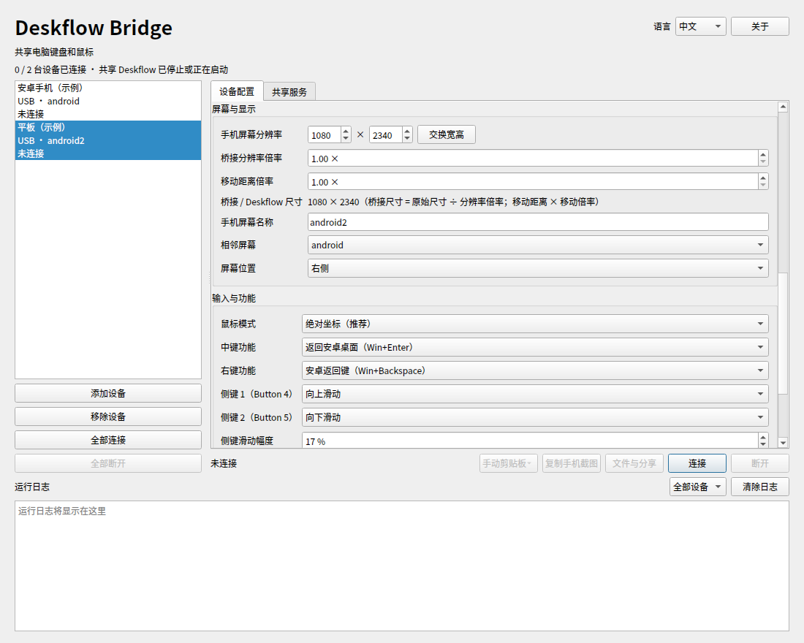

# Deskflow Bridge 用户指南

[English](USER_GUIDE.md) · [项目首页](../README.zh-CN.md) · [下载桌面版](https://github.com/gh6497/deskflow-bridge/releases)

**把手机放在电脑旁，用同一套键盘鼠标操作两边。** 鼠标从电脑屏幕边缘移过去，就能在安卓手机上点击、滚动和打字；移回来，继续使用电脑。

这份指南面向直接下载安装软件的用户，不需要编译代码。你操作时仍然看手机自己的屏幕：本项目不提供手机画面投屏，也不把手机变成显示电脑窗口的扩展显示器。

> 截图来自当前版本的实际 Linux GUI，使用演示设备和文件；`TEST123`、地址、安装路径和分辨率都是示例，请使用你自己的值。Windows/macOS 的外观可能不同，部分选项取决于平台及安装包版本。截图不是手机兼容性验证结果。

## 目录

- [1. 可以用它做什么](#features)
- [2. 下载、安装与准备](#install)
- [3. 选择连接方式](#connection)
- [4. 认识主窗口](#interface)
- [5. 第一次连接：USB 数据线 + ADB＋UHID](#first-connection)
- [6. 不开 USB 调试：USB（AOA HID）](#aoa)
- [7. 日常操作与手感调整](#daily)
- [8. 按需开启附加功能](#extras)
- [9. 同时连接多台手机](#multiple)
- [10. 蓝牙连接](#bluetooth)
- [11. 遇到问题怎么办](#troubleshooting)
- [进一步阅读](#more)

<a id="features"></a>

## 1. 可以用它做什么

- **键鼠跨屏控制**：鼠标滑到手机一侧后，点击、拖动、滚轮和键盘输入都交给手机处理。
- **手机导航**：可把中键设为返回桌面、右键设为返回，侧键设为上滑或下滑。
- **多设备切换**：为手机和平板分别保存设置，按屏幕布局把鼠标移到想操作的设备。
- **文本复制粘贴**：开启共享后，在电脑复制文本，到手机粘贴；也支持手机向电脑同步。
- **手机声音从电脑播放**：Linux/macOS/Windows 可开启音频转发。
- **图片和文件双向传输**：配合可选的手机伴侣应用，把手机分享的内容接收到电脑，或把电脑文件发送到手机。
- **减少重复操作**：保持程序在托盘运行，已记住的 AOA 或有线 ADB＋UHID 手机可以插线自动连接。

先完成键鼠连接即可使用核心功能。剪贴板、音频、文件分享等需要额外的 ADB 连接；文件分享还需要伴侣应用，后面会分别说明。

<a id="install"></a>

## 2. 下载、安装与准备

### 电脑上需要两个软件

1. 安装 [Deskflow](https://github.com/deskflow/deskflow/releases)：负责接收电脑的键盘鼠标并管理跨屏切换。
2. 在本项目的 [Releases](https://github.com/gh6497/deskflow-bridge/releases) 页面展开 **Assets**，下载名称以 **`deskflow-bridge-gui-`** 开头的桌面版。

桌面安装包包含桥接程序、界面运行库和 ADB，**不包含 Deskflow**。通常不需要另外安装 scrcpy。不要把 GitHub 自动生成的 `Source code` 源码压缩包当作安装包。

### 按电脑系统选安装包

| 电脑系统 | 选择的文件 | 如何启动 |
| --- | --- | --- |
| Windows x64 | `…-windows-x86_64-setup.exe` | 运行安装程序，完成后从开始菜单打开 Deskflow Bridge |
| Windows 便携版 | `…-windows-x86_64.zip`（名称含 `gui`） | 完整解压，运行 `bin/deskflow-bridge-gui.exe`；在同一目录运行 `Uninstall.exe` 可删除本程序 |
| Ubuntu / Debian / Linux Mint x86_64 | `…-linux-amd64.deb` | 用系统软件安装器安装，再从应用菜单打开 |
| 其他 Linux x86_64 桌面 | `…-linux-x86_64.AppImage` | 在文件属性中允许作为程序执行，再双击；系统需要 FUSE |
| Apple 芯片 Mac | `…-macos-arm64.dmg` | 打开后把应用拖到「应用程序」 |
| Intel Mac | `…-macos-x86_64.dmg` | 打开后把应用拖到「应用程序」 |

Windows 安装程序和 macOS 镜像当前未签名/公证，首次打开可能遇到系统提示；核对下载来自上面的项目发布页。macOS 可在「系统设置 → 隐私与安全性」中选择「仍要打开」。Linux 的安装命令和 AppImage 无 FUSE 的启动方法见 [README 的预编译包说明](../README.zh-CN.md#发布预编译包)。

### 手机和系统权限

- 一台安卓手机或平板，以及支持**数据传输**的 USB 线；仅充电线无法连接。
- 初次设置时保持手机解锁，便于确认授权和观察指针。
- 使用 ADB＋UHID 时，在手机开启 USB 调试并授权电脑；无需 root。
- macOS 需要给 **Deskflow** 辅助功能权限；若系统再询问输入监控或 USB 配件访问，也按提示允许。
- Linux Wayland 桌面可能弹出键鼠共享授权；Linux USB 访问还需要相应设备权限。

首次配置建议先只连接一台手机。

<a id="connection"></a>

## 3. 选择连接方式

“AOA”“UHID”是界面中的模式名称，选择时主要看是否愿意开启调试、使用哪种连接。

| 你的需求 | 选择 | 需要准备 |
| --- | --- | --- |
| 使用 USB 数据线，愿意开启调试；尤其是 Windows | **ADB＋UHID（USB／无线）** | 开启并授权 USB 调试；Windows 保持普通 ADB 驱动 |
| 只想用键鼠，不开启 USB 调试 | **USB（AOA HID）** | USB 访问权限；Windows 还需兼容 libusb 的驱动 |
| 想通过 Wi-Fi 控制 | **ADB＋UHID（USB／无线）** | 手机支持无线调试，并完成配对和连接 |
| 想用蓝牙控制且不依赖 ADB | **低功耗蓝牙** | 兼容的 Linux 蓝牙环境，或包含实验性 BLE 的 Windows 安装包 |

**第一次使用推荐先走下一节的 USB + ADB＋UHID 流程**，尤其在 Windows 上可避免 AOA 的 USB 驱动替换。Linux/macOS 新配置默认可能是 AOA，需要手动切换。若不想开启调试，直接看 [AOA 流程](#aoa)。

无线 ADB 和蓝牙是两种不同的连接方式。macOS 当前没有 BLE 模式。若界面没有某项功能，先查看所用发布版本包含的功能。

<a id="interface"></a>

## 4. 认识主窗口



- **左侧设备列表**：选择当前要查看、设置或连接的手机。下方可添加设备、全部连接或全部断开。
- **设备配置**用于选择连接方式、手机、屏幕尺寸和输入功能。**右侧内容可以向下滚动**，屏幕设置、鼠标按键和伴侣应用在较下方。自动启动 Deskflow 时，在「屏幕与显示」中设置手机的相邻屏幕和方向。
- **共享服务**：选择 Deskflow 程序，以及自动启动或连接已有服务。
- 右下角的 **「连接」**、**「断开」**、**「复制手机截图」**和 **「手动剪贴板」**都作用于选中的设备。**「文件与分享」**打开文件窗口。
- **底部运行日志**：连接出问题时查看原因，可按设备筛选。
- **右上角语言**：可随时切换中文和英文；界面外观跟随系统主题。

<a id="first-connection"></a>

## 5. 第一次连接：USB 数据线 + ADB＋UHID

### 第一步：让电脑识别手机

1. 在手机设置中开启「开发者选项」和「USB 调试」。不同品牌入口不同，通常在「关于手机」中连续点击版本号，再回到设置查找开发者选项。
2. 用数据线连接电脑，解锁手机，在「允许 USB 调试」提示中允许这台电脑。
3. 打开 Deskflow Bridge，在「设备配置 → 连接方式」选择 **ADB＋UHID（USB／无线）**。
4. 点击「刷新设备」，在设备列表中选择显示**在线**的手机。只有一台时通常会自动选中；「ADB 目标（必填）」会填入它的标识。
5. 可以点击「测试 ADB」确认目标可用。

显示“未授权”时先看手机的授权弹窗，再刷新。Windows 若始终没有设备，检查手机厂商的 ADB 驱动；在这个模式下不需要换成 WinUSB。

### 第二步：确认屏幕尺寸

点击「读取屏幕尺寸」，然后向下滚动到「屏幕与显示」。



- **手机屏幕分辨率**：填写手机当前方向的宽 × 高。示例竖屏为 `1080 × 2340`，你的手机可能不同。读取失败时可以手动填。
- **交换宽高**：手机改为横屏时可用这个按钮调整。
- **桥接分辨率倍率、移动距离倍率**：首次都保持 `1.00 ×`。
- **手机屏幕名称**：单台手机保留 `android` 即可。它是 Deskflow 中的识别名称，不是手机型号。
- **鼠标模式**：保持「绝对坐标（推荐）」。

先保持音频、剪贴板、自动解锁等附加开关关闭，连通后再按需开启。

### 第三步：安排手机的位置

如果由桥接程序自动启动 Deskflow，打开「设备配置 → 屏幕与显示」。把「相邻屏幕」设为 `computer`，「屏幕位置」设为手机相对于电脑的方向。选「右侧」后，鼠标从电脑的右边缘移入手机。使用已有服务时，在 Deskflow 中设置位置。

### 第四步：设置 Deskflow

打开「共享服务」：

1. 勾选 **「自动配置并启动本机 Deskflow」**。
2. 单台电脑可保留电脑屏幕名称 `computer` 和端口 `24800`，本机服务地址自动使用 `127.0.0.1`。
3. 下方「程序与模式」中的 **Deskflow** 一栏会尝试找到已安装的程序。如果为空，点「浏览」选择 **`deskflow-core` 或 `deskflow-server`**（Windows 带 `.exe`），不是 Deskflow 的图形界面程序。Mac 通常在 `/Applications/Deskflow.app/Contents/MacOS/` 中。
4. **ADB** 一栏通常已指向随包附带的程序，无需修改。图中的 Linux 路径仅为示例。



自动模式会在你点击「连接」时启动 Deskflow，不必再手动启动一个占用同端口的服务。

**已经在用 Deskflow？** 取消自动启动，填写现有服务的地址和端口。在 Deskflow 中添加同名的手机屏幕，例如 `android`，并设置它的位置。如果现有服务开启 TLS，还要在这里启用 TLS 并填写它的服务端指纹。需要客户端认证时，生成客户端证书并在 Deskflow 中信任该客户端指纹。详见 [TLS 说明](../README.zh-CN.md#tls-说明)。

### 第五步：连接并试用

1. 点击右下角 **「连接」**，等待状态变为 **「已连接」**。
2. 如果布局选择右侧，把鼠标移到电脑屏幕最右边并继续向右移动。手机上应出现可以移动的指针。
3. 在手机上点击一个文本输入框，用电脑键盘输入几个字；试一下滚轮、拖动和返回。
4. 从手机屏幕朝电脑所在方向移出，鼠标就回到电脑。在右侧布局中，就是向手机屏幕左边移出。

界面显示“已连接”后，还应实际试一下手机是否响应。若手机没有指针，见 [故障排查](#troubleshooting)。

<a id="aoa"></a>

## 6. 不开 USB 调试：USB（AOA HID）

这个模式可以只用数据线和键鼠，不安装手机伴侣、不启用 ADB。



1. 在「连接方式」选 **USB（AOA HID）**，关闭「启用 ADB 增强功能」。
2. 插入手机后点「刷新设备」，选择对应的 USB 设备。识别不到时先检查数据线和 USB 权限；也可在手动模式填写正确的 USB 序列号。
3. 手动填写手机当前方向的宽高；这里的 **USB 序列号**不是 Wi-Fi 地址，也不是 BLE 地址，不要照抄截图中的示例。
4. 按上一节设置手机位置和「共享服务」，然后连接。

Linux 需要 USB 访问权限，设置方法见 [Linux USB 权限说明](../README.zh-CN.md#linux-免-root-访问-usbudev-规则)。macOS 若询问是否允许配件连接，请允许。Windows 的 AOA 需要兼容 libusb 的驱动，可能与原来的 ADB/文件传输驱动冲突；操作前阅读 [Windows USB 说明](WINDOWS_USB.md)，也可改用前面的 ADB＋UHID。

<a id="daily"></a>

## 7. 日常操作与手感调整

### 点击、返回和滚动

- 左键点击；按住左键移动可以拖动。
- 滚轮用于滚动，具体效果取决于手机应用。
- 新建 GUI 配置默认中键返回安卓桌面，右键执行安卓返回。需要普通鼠标中/右键行为时，在「输入与功能」中改为普通按键。旧配置保留之前保存的选择。
- 侧键 1 默认向上滑动，侧键 2 默认向下滑动；「侧键滑动幅度」默认 `17%`。可以修改方向或恢复普通侧键。
- 这些导航动作不需要伴侣应用或 ADB；Home/Back 是否生效取决于手机系统对相应快捷键的支持。

### 鼠标移动太慢或太快

先断开当前设备再调整，建议每次只改一项：

- **移动距离倍率**：增大后，同样的电脑鼠标位移会让手机指针移动更远。
- **桥接分辨率倍率**：增大后，手机在 Deskflow 中的虚拟屏幕变小，也会改变跨越手机屏幕所需的移动量。它**不会降低手机实际显示清晰度**。
- 优先保持「绝对坐标」。相对模式用于兼容个别设备，可能因手机鼠标加速出现位置漂移。

如果旧版 Android 手机的绝对指针只能移到屏幕中间，先断开该设备，在 **「设备配置 → 输入与功能」** 中勾选 **「兼容旧版 Android 指针」**，再连接。此设置用于该设备的 USB 和蓝牙连接。

手机旋转后，未开启跟随旋转时请断开，重新读取尺寸或「交换宽高」，再连接。

### 断开、收起和退出

- **断开**：结束当前设备的控制；**全部断开**：结束所有设备的控制。
- **关闭窗口**：有系统托盘时只隐藏窗口，连接仍然保留。点击托盘图标或「显示窗口」可恢复。
- **退出程序**：从托盘菜单选「退出」。没有系统托盘的桌面，关闭窗口会断开并退出。
- 配置会自动保存；切换左侧选中的设备不会断开其他手机。

### 插入 USB 数据线时自动连接

在手机的设备配置中选择 **ADB＋UHID** 或 **USB（AOA HID）**。有线 UHID 需要先在手机上授权 USB 调试，再选中手机的 USB ADB 序列号，不要填写 Wi-Fi 地址；AOA 无需 USB 调试。

勾选 **「USB 插入时自动连接此设备」**（默认关闭），手动连接一次，直到显示 **「已连接」**。之后保持程序运行（可隐藏到托盘），下次插入这台手机就会自动连接。如果 UHID 在等待授权，请在手机上确认 USB 调试提示。

手动断开或连接失败后，可以点「连接」立即重试，也可以重新拔插数据线。退出程序后停止检测；此开关不监测无线 ADB。

<a id="extras"></a>

## 8. 按需开启附加功能

先断开需要修改的设备，在「设备配置 → ADB 增强功能」中设置，再重新连接。AOA/BLE 需另外开启 ADB 增强并为**同一台手机**选择已授权的 ADB 目标；UHID 已经必需启用 ADB。蓝牙本身不能替代这里的 ADB 连接。

### 共享文本剪贴板

勾选 **「共享文本剪贴板」**，连接后在电脑复制文本，把鼠标移到手机，在输入框中粘贴；从手机复制文本也可同步回电脑。不需要伴侣应用。

这里共享的是文字，图片和文件请使用下面的「文件与分享」。开启后，在后台手机上复制文本也可能更新共享剪贴板。

### 手动传输剪贴板文本

在左侧选中手机，打开窗口底部的 **「手动剪贴板」**。

- **「从手机复制到电脑」**把手机剪贴板里的最新文本复制到运行 GUI 的这台电脑。
- **「从电脑发送到手机」**把这台电脑剪贴板里的当前文本发送到手机剪贴板。发送成功后，在手机上需要的位置粘贴。

每次点击只传输一次。关闭 **「共享文本剪贴板」**或尚未连接 Deskflow 时也可使用。选中的手机需已在 ADB 中上线并授权。使用 AOA/BLE 时需开启 **「ADB 增强功能」**，BLE 还需填写同一台手机的无线 ADB 地址。

支持最多 262,130 字节的 UTF-8 纯文本。读取成功后才覆盖电脑剪贴板。如果手机剪贴板无法读取，请解锁手机，复制一段文本后重试。

### 复制手机截图

在左侧选中手机，点击右下方的 **「复制手机截图」**。窗口隐藏时，可在托盘选择 **「复制手机截图 → 设备名」**。看到复制成功的提示后，到支持图片的聊天或文档里按 **Ctrl+V**（macOS：**⌘V**）。图片在运行 GUI 的电脑的剪贴板里，即使 Deskflow 服务在另一台电脑上也是如此。

手机需要已在 ADB 中在线并授权这台电脑。AOA/BLE 需开启 **「ADB 增强功能」**，BLE 还需显式填写同一手机的无线 ADB 地址。不需要伴侣应用、文本共享或已连接的 Deskflow 会话。手机离线、截图失败或超时都会保留原剪贴板；Android 可能将受保护内容显示为黑屏。

### 转发手机声音

Linux/macOS/Windows 可在 **「ADB 增强功能」** 中勾选 **「转发音频」**，连接后手机音频由电脑播放。该开关按设备保存，默认关闭。需要 Android 11 或更高版本及已授权的 ADB；Android 11 首次启动采集时应保持解锁，通话、受保护内容或不允许捕获的应用可能没有声音。

**转发声音偏小时**：先断开该设备，保持勾选 **「转发音频」**，在下方设置 **「转发音量增益」**。建议先试 `3 dB` 或 `6 dB`，重新连接后试听。范围 `0–12 dB`，按设备保存；`0 dB` 保持原来的声音。增益只放大电脑播放的声音，不改变手机媒体音量，也不能恢复未采集到的声音。Windows BLE 模式更改增益后，需要先点 **「停止空闲蓝牙服务」** 再连接。

macOS 使用系统默认输出（扬声器或耳机），无需麦克风权限或额外音频驱动。没有声音时，先在系统设置中检查输出设备和音量，选好可用输出后断开并重新连接。音频输出失败会写入日志，键鼠控制仍可继续。构建必须包含音频功能；旧版 macOS 包可能没有此开关。

正常断开音频会话时，程序会尝试请求手机暂停播放。拔线或 ADB 已掉线时不能保证暂停；需要拔线暂停时可配置下方的伴侣应用。

### 跟随屏幕旋转

开启 **「跟随屏幕旋转」**后，可根据手机方向更新控制尺寸。UHID 单独使用即可跟随；AOA/BLE 还需启用音频或剪贴板来提供持续的 ADB 会话。

### 手机唤醒与数字 PIN 解锁

UHID 模式会在鼠标切入手机时发送唤醒动作。手机仍需正常解锁；也可选择开启 **「进入手机时尝试自动输入数字 PIN 解锁」**，填写该手机的数字 PIN。程序通过 ADB 确认手机锁定后，会尝试打开 PIN 输入界面，再发送 PIN 和回车。

默认按空格键打开 PIN 输入界面。如果手机锁屏不响应空格键，取消勾选 **「用空格键代替上滑」** 并重新连接，即可改用上滑。上滑需要绝对坐标模式。此选项按设备保存。

这是可选功能。开启后 PIN 会保存到电脑本地配置，不写入运行日志；不想在电脑保存 PIN 时保持关闭，手动解锁即可。

OPPO R17（Android 10）的 PIN 界面在使用实体键盘输入时不会显示圆点。请用字母上方的数字键输入完整 PIN，再按主键区的回车键。如果不确定刚才输入了什么，可以用手机屏幕上的数字键解锁。

### 安装可选的手机伴侣

键鼠、文本剪贴板和音频转发本身不要求安装伴侣。**文件分享、手机上的连接状态显示、拔 USB 暂停媒体等**使用伴侣应用。

1. 确认同一台手机的 ADB 已授权且在线；在设备配置页向下滚动到「伴侣应用（可选）」（USB/UHID 页）。
2. 桌面发布包通常已带 APK，点击 **「安装 / 更新 APK」**；它不会自动安装。
3. 点击 **「打开手机端设置」**，在手机上打开伴侣。若要使用媒体暂停/自动播放，按提示手动允许通知使用权；仅文件分享不需要该权限。
4. 手机有自启动、后台运行或电池限制时，为伴侣允许后台运行并取消电池限制。安装或更新后在手机上打开一次。

要在手机上收到提醒，在伴侣首页开启 **「Deskflow 连接或断开时通知」**（默认关闭），并允许 App 发送系统通知。它不需要媒体控制用的「通知使用权」。桌面 GUI 通过已授权的 ADB 上报后，手机会在连接成功和该会话断开时各提醒一次。更新桌面端和伴侣 App 后，已确认的有线会话即使拔线后 ADB 离线，也可由手机直接提醒；没有 Deskflow 会话时，仅插拔 USB 不会触发通知。

伴侣可以在 USB 数据连接断开时请求暂停正在播放的媒体；短暂断线也可能触发，且不限于 Deskflow 使用的 USB 连接。自动播放需要在手机伴侣中单独开启并选择播放器，默认关闭。播放器是否执行仍取决于应用和系统。

### 传图片和文件



**手机 → 电脑**

1. 在手机相册、文件管理器或其他应用中选中内容，使用系统「分享」，选择 **「分享至电脑」**。
2. 在手机确认 **「准备分享」**。
3. 在桌面选中对应手机，点 **「文件与分享」→「刷新手机分享」**。
4. 选中文件，点 **「接收所选文件」**，选择电脑上的保存目录。

**电脑 → 手机**

1. 在同一窗口点 **「发送文件到手机」**，选择文件；也可把本地文件拖入这个窗口后确认。
2. 等待显示完成。手机伴侣的「文件与分享」中刷新列表，对文件点 **「另存为」**并选择位置。
3. 如果希望自动出现在相册或指定目录，可在手机伴侣中启用自动保存，并授予对应保存位置的访问权。

传输默认不覆盖或自动打开文件。单文件上限 `1 GiB`，手机暂存合计最多 `32` 个文件 / `2 GiB`；支持文件而非整个目录。分享文本会保存为文本文件，不等同复制粘贴。长时间传输建议保持伴侣前台、手机亮屏，完成后再收起。要换另一台手机传输，先关闭文件窗口，再选目标设备重新打开。

### 使用无线 ADB

手机支持无线调试时（通常为 Android 11+），可以让 UHID 通过 Wi-Fi 工作：

1. 手机和电脑连接同一个可互通的网络，在手机「开发者选项 → 无线调试」中开启功能。
2. 在桌面点 **「无线 ADB 配置助手」**；在手机选择使用配对码配对。
3. 在助手中选择发现的配对地址，或填写手机配对窗口显示的 IP 和端口，输入手机显示的六位配对码并配对。
4. 再选择手机无线调试**主页**的连接地址和端口，连接成功后目标会回填到设备配置。
5. 选择 ADB＋UHID，读取尺寸，按前面的流程连接。

**配对端口和连接端口可能不同。** 切换网络、重开无线调试后地址或端口也可能变化，需要更新；手机伴侣的无线 ADB 助手只能帮助打开系统设置，不能替你完成系统授权。

<a id="multiple"></a>

## 9. 同时连接多台手机



1. 全部断开后点 **「添加设备」**，为每台手机选择自己的连接目标和尺寸。
2. 新设备会获得不同的 **手机屏幕名称**，例如 `android2`、`android3`，已有名称不会更改。使用外部 Deskflow 服务时，两边的屏幕名称须一致。「显示名称」可以使用方便自己辨认的名字。
3. 自动启动 Deskflow 时，选中每台设备并打开「设备配置 → 屏幕与显示」。例如第一台的「相邻屏幕」选 `computer`，第二台选 `android`，两台的「屏幕位置」都选「右侧」。使用已有服务时，在 Deskflow 中排列屏幕。
4. 在「共享服务」配置一次 Deskflow，然后逐台连接或点 **「全部连接」**。

可以同时连接多台 AOA/UHID 设备。默认蓝牙服务支持一台手机。Linux 的实验性双机服务支持同一适配器上的两台 BLE 手机，各占一个屏幕。鼠标在哪台屏幕上，就操作哪台。断开一台后，另一台仍可使用。

**在 Linux 上连接两台 BLE 手机**

1. 先准备带定向通知修复的 BlueZ（上游 5.76+，或确认已回移修复的构建）。Ubuntu 原版 `5.72-0ubuntu5.8` 只适合单机。在项目根目录，将 `FIXED_DAEMON` 设置为来源已核实、包含该修复的参考二进制文件，再运行以下核验命令。脚本会与正在运行的守护进程逐字节比对。重启 BlueZ 后需重新核验。

   ```sh
   sudo sh scripts/ble-verified-instance.sh "$FIXED_DAEMON"
   ```

2. 在 GUI 中为两台手机分别设置蓝牙连接、`hci0`、各自的手机蓝牙身份地址和不同的屏幕名称。需要旧版 Android 键鼠兼容时，两台均开启该选项，并关闭**设备配置中的蓝牙隔离**。R17 开启绝对坐标分轴缩放。如果已有旧版蓝牙服务，先断开会话，然后点击「停止空闲蓝牙服务」。
3. 在 GUI 点击第一个屏幕的「连接」。确认切换到仅 BLE 模式并完成管理员认证。切换会断开该适配器上的所有蓝牙连接。两个屏幕共用同一服务。点击第二个屏幕的「连接」，然后分别从手机的系统蓝牙设置连接 **Deskflow Bridge**。两台手机都可以先接入。
4. `deskflow-bridge --ble-status --adapter hci0` 中的 `directed: true` 和 `bleOnly: true` 表示共享的仅 BLE 双机服务。手机接入或掉线后，有空位时服务会刷新 BLE 广播。重连时若日志停在 `waiting for fresh keyboard and pointer subscriptions`，可先关开**该手机**的蓝牙，再从系统设置中连接。最后一个桥接会话退出后，服务会恢复适配器。

要新增/删除设备、更改屏幕名称、布局或共享服务，先全部断开并等待停止完成。已连接设备的参数会锁定，其他空闲设备的连接目标和尺寸仍可编辑。

<a id="bluetooth"></a>

## 10. 蓝牙连接

BLE 可让手机把电脑当作蓝牙键鼠，核心输入不需要 USB 调试。这个方式对适配器和手机兼容性要求较高，建议先用有线方式熟悉基本操作。

- **Linux 单机模式**下选择低功耗蓝牙，填写适配器（通常为 `hci0`）和屏幕尺寸，点击「连接」。打开手机蓝牙设置，与 **Deskflow Bridge** 配对或连接。手机必须是该适配器上唯一的 LE 连接。Linux 能确认两路键鼠订阅都来自这条 LE 链路时，经典蓝牙可以同时使用。首次可保持「蓝牙隔离」关闭，以免同一适配器上的其他设备断开。
- **Windows** 上使用包含实验性 BLE 的构建，选择低功耗蓝牙，填写屏幕尺寸并点击「连接」。从手机的蓝牙设置与电脑配对或连接。配对和控制取决于适配器和手机的兼容性。
- **macOS**：当前没有 BLE 后端；无线控制可考虑无线 ADB＋UHID。

「手机地址（选填）」留空时，服务会选定第一台已配对、已连接且订阅键盘和指针报告的手机，并记住这台手机直到服务停止。要换手机，先断开会话并点击「停止空闲蓝牙服务」，然后从新手机连接。需要预先限定目标时，请填写电脑蓝牙系统识别到的手机稳定地址。详见 [Linux 蓝牙说明](LINUX_BLE_HANDOVER.md)和 [Windows 蓝牙说明](WINDOWS_BLE.md)。

普通「断开」与「停止空闲蓝牙服务」不同。Linux GUI 退出会保留常驻服务；Windows 在 GUI 仍运行时保留空闲服务，退出才停止。不要把停止服务或删除配对当作每次重连的必经步骤，重启后的配对缓存表现仍可能因设备而异。

如果旧版 Android 手机在 Linux 上已配对、键鼠却迟迟未就绪，先断开会话并点击 **「停止空闲蓝牙服务」**，再为该手机勾选 **「兼容旧版 Android 蓝牙键鼠」** 后重连。若手机仍使用旧缓存，可先关开一次手机蓝牙，必要时在手机和电脑两端取消配对后重新配对。如果手机只连上经典蓝牙，可勾选独立的 **「临时使用仅 BLE 模式（需要管理员认证）」** 来测试 BLE。该选项会暂时断开此适配器上的所有连接。

**如果光标一跳一跳地走**，可以查看日志里是否记录了连接间隔。间隔越长，手机接收新坐标的机会越少。Windows 上查找 `BLE negotiated connection interval`（`12500us` 表示 12.5 毫秒）。Linux 开启蓝牙隔离时查找 `BLE actual interval`。反馈时请附上这一行，并说明普通移动和按住拖动时是否都有顿挫。

### 用伴侣 App 查找电脑

1. 在桌面 GUI 启动这台手机的 BLE 会话。打开手机伴侣 App，点击 **「蓝牙连接 → 扫描 BLE 设备」**。Android 12 及以上需要授权「附近设备」。Android 10 和 11 扫描时需要允许定位权限并开启系统定位。
2. 在扫描结果里点选电脑即可填入地址。如果列表为空，直接填写电脑适配器的公开蓝牙地址。点击 **「测试 LE 连接」** 查看结果。若超时，请核对地址，并检查电脑是否在广播。
3. 点击 **「连接电脑」**，按系统提示确认配对。App 会记住电脑地址，显示 Android 报告的蓝牙链路状态和类型。在桌面查看连接状态并试用键鼠。

手机可以独立发起和查看蓝牙链路。更新后的桌面 GUI 通过已授权的 ADB 上报时，App 首页会显示 Deskflow 状态和连接方式（AOA HID、ADB＋UHID 或 BLE HID）。详见 [Android 伴侣应用文档](ANDROID_COMPANION.md#ble-diagnostics)。

<a id="troubleshooting"></a>

## 11. 遇到问题怎么办

| 现象 | 先检查什么 |
| --- | --- |
| 连接时提示配置错误 | 状态和运行日志会指出首个有问题的配置项及其要求，例如端口须为 1～65535、宽高须为 1～32767、缺少 ADB 目标或 TLS 指纹设置冲突。修正后重新连接；若还有其他问题，下次会继续提示。此类提示不会包含 PIN 内容 |
| 刷新后找不到手机 | 换可传数据的线/USB 接口；UHID 检查调试授权和 ADB 驱动，AOA 检查 USB 权限和驱动 |
| 显示“未授权”或“离线” | 解锁手机并确认授权，再刷新；无线连接检查当前 IP、连接端口和网络 |
| 没有找到 Deskflow | 先安装 Deskflow，再在共享服务中选择 `deskflow-core` / `deskflow-server`，不要选择它的 GUI |
| 提示端口被占用 | 检查是否已经手动启动 Deskflow；使用已有服务模式，或为自动服务改用空闲端口 |
| Linux 蓝牙服务不可用 | 打开 GUI 提示路径中的服务日志。`deskflow-bridge --ble-status --adapter hci0` 显示 `available: false` 时，说明桥接程序未收到服务的有效回复 |
| 提示未知屏幕、名称不匹配 | 外部 Deskflow 的手机屏幕名称要与本程序完全一致，且不能与其他屏幕重名 |
| 已连接，但鼠标移不进去 | 自动启动模式检查「屏幕位置」，外部服务模式检查 Deskflow 的布局。也请检查 Deskflow 的辅助功能或键鼠捕获权限，以及是否启用了切屏锁定 |
| 手机上没有指针或点击不响应 | 查看运行日志是否提示 UHID 不可用或 USB 错误；保持绝对模式先试，个别设备可断开后尝试相对模式 |
| 横竖方向不对、移动范围奇怪 | 断开，读取当前方向尺寸或交换宽高；先把两个倍率恢复到 1 |
| 某些符号键不对 | 将手机的物理键盘设为英语（美国）。Deskflow 协议 1.8 提供逐键语言时，可修正其它电脑布局中的 `@`、`#`、`1` 等常见符号和数字。桥接不会切换手机布局，也不会修正重音字母和死键。 |
| 剪贴板、音频或文件不能用 | 检查该手机的 ADB 目标是否在线且授权；文件分享还要更新并打开伴侣；音频需要支持的平台和 Android 版本 |
| 发送到手机的文件没出现在相册 | 在伴侣「文件与分享」中刷新并另存，或开启相应自动保存；默认先放在伴侣私有空间 |
| 关窗口后仍在控制手机 | 有托盘时关闭只是隐藏；在托盘菜单选择断开或退出 |

运行日志中，应用自己的提示跟随界面语言。标为 `[ADB 原始输出]`、`[Deskflow 原始输出]` 等的内容保留原文，方便排查。切换语言只影响新日志，已显示的日志不会重新翻译。

**需要反馈问题时**，在右上角「关于」查看版本，记录电脑系统、手机型号/Android 版本、连接方式、操作步骤，并附上底部相关日志或截图，到 [项目 Issues](https://github.com/gh6497/deskflow-bridge/issues) 反馈。先移除日志或截图中不想公开的设备标识和路径，不要附 PIN 或私钥文件。

<a id="more"></a>

## 进一步阅读

日常使用到这里即可；下面是需要详细设置或排障时的参考：

- [ADB＋UHID 的设备要求](UHID.md)
- [Windows USB 驱动与识别](WINDOWS_USB.md)
- [音频转发](AUDIO.md) · [文本剪贴板](CLIPBOARD.md)
- [Android 伴侣应用](ANDROID_COMPANION.md) · [文件分享](FILE_SHARING.md)
- [Windows BLE](WINDOWS_BLE.md) · [Linux BLE 兼容性记录](LINUX_BLE_HANDOVER.md)
- [技术说明、命令行与源码构建](../README.zh-CN.md)
